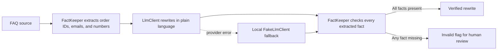

# FAQ Rewrite Desk

FAQ Rewrite Desk is a small Harbor Desk support-writing tool. Paste a customer FAQ and get a shorter, plain-language answer with order IDs, email addresses, and numbers extracted and checked before the rewrite is marked valid. The UI also includes three seeded FAQ examples and a recent rewrite list.

## How the AI design works



`App\Services\Llm\LlmClient` keeps provider details out of the FAQ workflow. With `GEMINI_API_KEY` configured the container uses Gemini and an HTTP timeout of 12 seconds. Without a key, it uses the deterministic local `FakeLlmClient`; if a provider call fails, the workflow also falls back locally. Every generated answer is fact-checked, and a dropped fact is stored as `invalid` rather than silently accepted.

## Run locally

Requirements: PHP 8.3+, Composer, Node.js 22+, and npm.

```bash
composer setup
php artisan db:seed
npm run dev
```

Open the URL shown by Vite/Laravel. No API key is needed: the app runs with the local fake rewrite client by default. To use Gemini, set `GEMINI_API_KEY` in `.env` (and optionally `GEMINI_MODEL`) and restart the app. The three sample FAQ answers are added by `DatabaseSeeder` and can be loaded into the editor with one click.

## Tests and quality checks

```bash
composer test
npm run check
npm run types:check
```

Pest tests verify deterministic extraction of IDs, email addresses, and numbers; that the `FakeLlmClient` is bound when no key exists; a guest can submit an FAQ successfully; the fake rewrite retains `HD-1001`; provider failures safely use the local fallback; and a model response that omits a protected fact is flagged invalid. These checks exercise both the positive and failure paths of the fact-preservation design without making network calls.

## Stack

- Laravel 13 and PHP 8.3+
- Vue 3, Inertia, and Tailwind CSS
- SQLite by default
- Optional Gemini API integration
